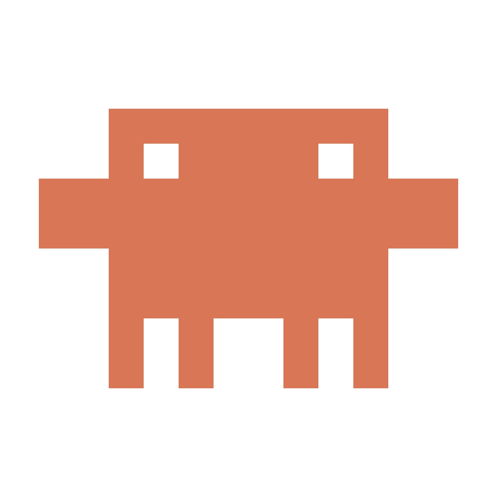

# Claude Pet

[繁體中文](#繁體中文) · [English](#english)

---

## 繁體中文

Windows 桌面寵物：Clawd 站在工作列上緣走來走去，並跟著 Claude Code 的狀態做反應。

| Claude Code 的狀態 | Clawd |
|---|---|
| 工作中 | 站上筆電、拿起小棒子敲個不停 |
| 等你核准（權限、提問） | 揮手、驚嘆號、氣泡「等你核准」、提示音 |
| 完成 | 跳一下、閃光、氣泡「完成了」、提示音 |
| 出錯 | X 眼、冒汗、氣泡「出錯了」、提示音 |

另外，游標停在 Claude 桌面版的輸入框時，頭上會出現三個點輪流跳動的氣泡。

### 需要什麼

- Windows 10 或 11
- [Claude Code](https://claude.com/claude-code)（寵物靠它的 hooks 得知狀態）
- 打字提示只支援 Claude 桌面版

不需要另外安裝 .NET 或 Node。

### 安裝

1. 到 [Releases](../../releases/latest) 下載 `ClaudePet-Setup.exe`。
2. 執行安裝檔。因為安裝檔沒有付費的程式碼簽章，Windows 可能會跳出「Windows 已保護您的電腦」。請按 **其他資訊** → **仍要執行**。
3. 選擇安裝資料夾，保持勾選「連動 Claude Code」，按下一步直到完成。

安裝完寵物就會出現，之後每次登入 Windows 也會自動啟動。**已經開著的 Claude Code 需要重開**，才會載入新的 hooks。

### 操作

- **左鍵點一下**：跳一下（頭上有「完成了／出錯了」氣泡時一併收掉）。
- **左鍵拖曳**：搬到別處，放手後掉回地面。
- **右鍵**：暫停／繼續走動、大小、提示音、打字提示、開機自動啟動、結束。
- 找不到寵物時再執行一次 Claude Pet：不會多開，會把原本那隻叫到滑鼠所在的螢幕。
- 寵物所在的螢幕被全螢幕程式（遊戲、影片）佔滿時會自動隱藏。

### 解除安裝

Windows「設定 → 應用程式 → 已安裝的應用程式」找到 **Claude Pet**，按解除安裝。會一併移除寵物加進 Claude Code 的 hooks、開機自動啟動與設定檔；你原本的其他 Claude Code 設定不會動。

### 安全與隱私

- 連動 Claude Code 時，安裝程式只會在 `~/.claude/settings.json` 新增指向 `ClaudePet.Hook.exe` 的 hooks，其他設定原封不動，並先備份成 `settings.json.bak-<時間>`。
- Hook 程式只把事件名稱傳給本機的寵物（本機 named pipe），不會連到任何網路，不輸出內容。
- 打字提示是透過 Windows 無障礙介面（UI Automation）看鍵盤焦點是不是輸入框，不監聽鍵盤，也不讀取你輸入的內容。
- 設定檔在 `%APPDATA%\ClaudePet`，記錄檔在 `%LOCALAPPDATA%\ClaudePet`。
- 這是非官方的個人專案，與 Anthropic 無關。

---

## English

A Windows desktop pet: Clawd walks along the top of your taskbar and reacts to what Claude Code is doing.

| Claude Code state | Clawd |
|---|---|
| Working | Stands on a laptop and taps away with a little stick |
| Waiting for approval (permission, question) | Waves, shows a "!" and a bubble, plays a sound |
| Done | Jumps, sparkles, shows a bubble, plays a sound |
| Error | X eyes, sweat drop, shows a bubble, plays a sound |

While the cursor is in the Claude desktop app's input box, three bouncing dots appear above the pet.

### Requirements

- Windows 10 or 11
- [Claude Code](https://claude.com/claude-code) (the pet learns its state from Claude Code hooks)
- The typing indicator works with the Claude desktop app only

No separate .NET or Node install is needed.

### Install

1. Download `ClaudePet-Setup.exe` from the [latest release](../../releases/latest).
2. Run it. The installer is not code-signed, so Windows SmartScreen may warn you. Choose **More info** → **Run anyway**.
3. Pick an install folder, keep "Connect to Claude Code" ticked, and click through the wizard.

The pet appears right away and starts with Windows from then on. **Restart any Claude Code session that is already open** so it picks up the new hooks.

### Controls

- **Left click**: jump (also dismisses a "done / error" bubble).
- **Left drag**: move it; it drops back to the ground when released.
- **Right click**: pause / resume walking, size, sounds, typing indicator, start with Windows, quit.
- Can't find it? Run Claude Pet again: no second pet is started, the existing one is called to the screen under your cursor.
- It hides itself while a full-screen program (game, video) covers its screen.

### Uninstall

Windows "Settings → Apps → Installed apps", find **Claude Pet** and uninstall. This also removes the hooks it added to Claude Code, its start-with-Windows entry and its settings; your other Claude Code settings are left alone.

### Security and privacy

- When connecting to Claude Code, the installer only adds hooks that run `ClaudePet.Hook.exe` to `~/.claude/settings.json`, leaves everything else as is, and backs the file up first as `settings.json.bak-<timestamp>`.
- The hook only passes the event name to the pet on your own computer (a local named pipe). It makes no network connections and prints nothing.
- The typing indicator asks Windows accessibility (UI Automation) whether keyboard focus is in an input box. It does not listen to the keyboard or read what you type.
- Settings live in `%APPDATA%\ClaudePet`, the log in `%LOCALAPPDATA%\ClaudePet`.
- This is an unofficial personal project, not affiliated with Anthropic.
